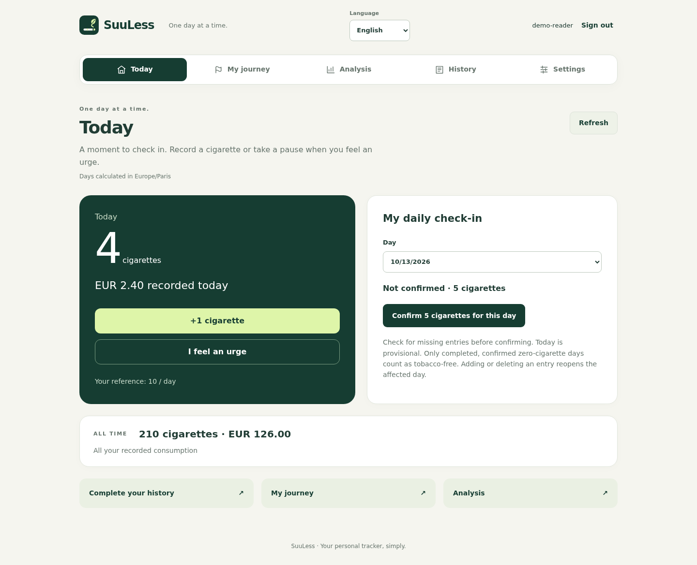

# SuuLess documentation

[Project home](../README.md)

Start with deployment to run your own instance, or the user guides if you already have an account. All guides are in English; the application supports English, French and Japanese.

## Use SuuLess

| Guide | What you will find |
|---|---|
| [Usage and statistics](user-guide/usage.md) | Entries, charts, historical costs, currencies and time zones |
| [Journeys and cravings](user-guide/coaching.md) | Goals, confirmations, craving pauses and reminders |
| [Android](user-guide/android.md) | Installation, screenshots, home-screen widget and signing behavior |
| [iPhone shortcut](user-guide/iphone-shortcut.md) | Create a SuuLess +1 shortcut and add it as a Home Screen button or widget |



## Deploy and operate

| Guide | What you will find |
|---|---|
| [Docker Compose](deployment/docker.md) | Quick start, HTTPS, registration, backups and upgrades |
| [Kubernetes](deployment/kubernetes.md) | Generic manifests, persistent storage, optional HTTPS and operations |
| [Example Kubernetes files](../deploy/kubernetes/) | Namespace, Deployment, PVC, Service and optional Ingress |

## Develop and integrate

| Guide | What you will find |
|---|---|
| [Development](development/README.md) | Local setup, Python/OpenAPI, browser and Android checks |
| [Architecture](development/architecture.md) | Component diagram, source map and limitations |
| [Synchronization](development/synchronization.md) | SSE sequence, Android background execution and proxy requirements |
| [API guide](api/README.md) | Authentication, request semantics and Stream Deck example |
| [OpenAPI contract](api/openapi.yaml) | Machine-readable request and response schemas |

## How the documentation is organized

```text
docs/
  user-guide/       Day-to-day use, Android and iPhone shortcuts
  deployment/       Docker and Kubernetes operations
  development/      Code, tests, architecture and synchronization
  api/              Integration guide and OpenAPI contract
  assets/
    diagrams/       Embedded SVGs and editable HTML sources
    screenshots/    Real application captures using demonstration data
```

Diagrams are embedded where they explain a flow; their HTML versions can also be opened in a browser. Web screenshots use English. Existing native Android screenshots use French and are labeled accordingly. See [visual assets](assets/README.md) for provenance and maintenance.

Maintainer-specific CI configuration, signing procedures and private infrastructure remain in the ignored `local/` directory.

- [Administration, invitations and SMTP](deployment/administration.md)
