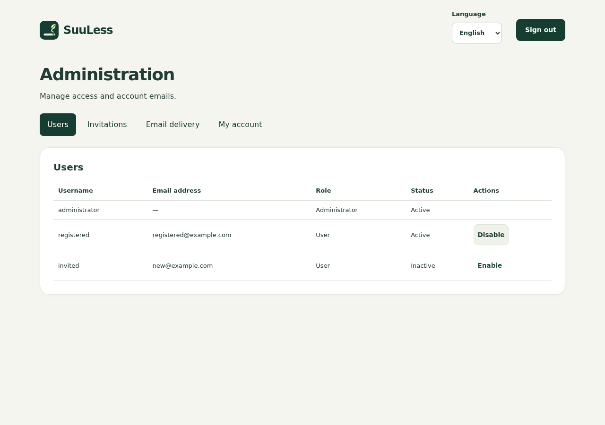
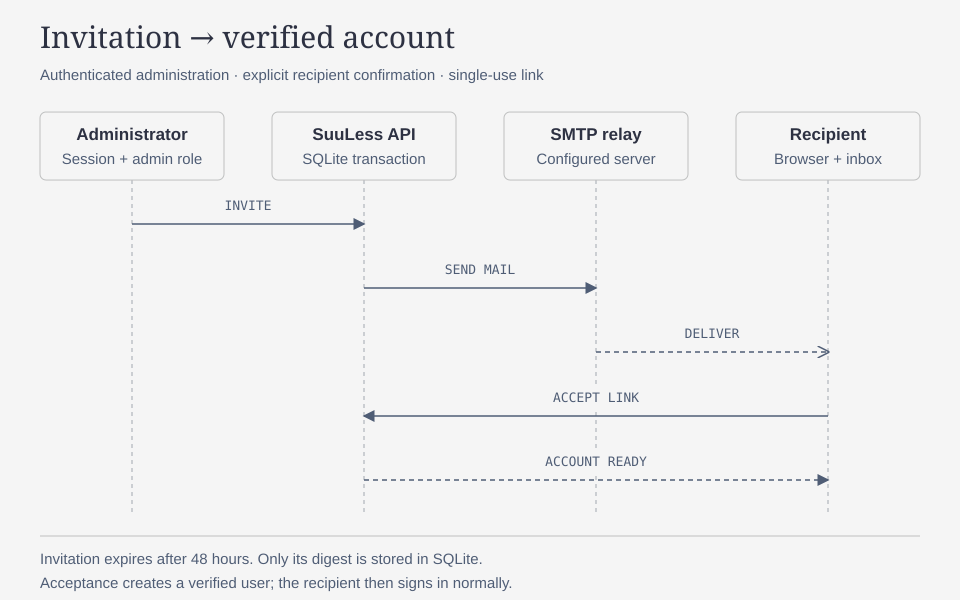

# Administration and account email

[Documentation](../README.md) · [Docker](docker.md) · [API contract](../api/openapi.yaml)

SuuLess separates administrators from people tracking consumption. Administrators sign in through the usual page and are redirected to `/admin`. They see user access, invitations, SMTP configuration and their recovery email. The header language selector persists English, French or Japanese per account. They have no consumption dashboard, analytics, history or consumption settings. Android directs administrators to the web administration page.

The API enforces this separation: administrative operations require an administrator **session**, not a personal API key. User accounts cannot call `/api/admin/*`; administrators cannot call consumption APIs or inspect another person's consumption. The admin list contains account identity and access status only. Administrators cannot disable or delete administrator accounts through this interface.



## First administrator and existing installations

To create the first administrator on either a new installation or an existing database without an administrator, configure:

```dotenv
ALLOW_REGISTRATION=false
ADMIN_USERNAME=administrator
ADMIN_PASSWORD='replace-with-a-long-unique-password'
```

The account is created with role `admin`, even when ordinary users already exist or public registration is disabled. Creation is transactional across startup workers. A dedicated persistent marker records administrator initialization separately from historical account initialization.

Use a username that is not already held by an ordinary user. A collision stops startup with an explicit error; no account is automatically promoted and no password or consumption data is changed. If an administrator already exists or administrator initialization was previously completed, these variables do not create another account or reset credentials. Deleting an initialized administrator through operator tooling does not cause automatic recreation. No predefined password is shipped.

After changing Kubernetes variables, restart/recreate the pod using an image containing this behavior. Earlier versions only initialized an administrator on an empty installation. On those versions, use the interactive command below without deleting the database or PVC.

Alternatively, create a dedicated administrator interactively (also available in earlier versions with admin support):

```sh
docker compose exec stop-clop flask --app server.app:create_app create-admin
```

The command prompts for a username and password, refuses existing usernames, and does not change another account. It also provides an operator recovery route when the administrator cannot sign in. No password reset is triggered by changing `ADMIN_PASSWORD` after initialization.

## Configure SMTP

In **Administration → Email delivery**, configure:

| Field | Meaning |
|---|---|
| Enable account emails | Activates email delivery and verification for new public registrations |
| SMTP host and port | Your existing mail server or relay |
| Connection security | STARTTLS, TLS from connection start, or no encryption for a trusted local relay |
| Username and password | Optional relay authentication |
| Sender email | Authorized sender address |
| Public application URL | Origin used in email links, for example `https://suuless.example.com` |

Save, then use **Send test email**. The application does not install a mail server. TLS certificates and hostnames are verified. A failed send shows a generic error without SMTP credentials. An empty password input preserves the saved password; **Clear password** removes it.

SMTP settings configured through the interface, including the relay password needed for authentication, are persisted in SQLite. The password is never returned by the settings API or printed in application errors. Restrict access to the persistent volume and its backups, which contain this credential. The public URL is configured explicitly; email links are never built from the request Host header.

## Configure SMTP with environment variables

Alternatively, set these variables in `.env` for Docker Compose, or inject them into the container environment in Kubernetes:

```dotenv
SMTP_ENABLED=true
SMTP_HOST=smtp.example.com
SMTP_PORT=587
SMTP_SECURITY=starttls
SMTP_USERNAME=mailer
SMTP_PASSWORD='replace-with-your-relay-password'
SMTP_FROM=suuless@example.com
SMTP_PUBLIC_URL=https://suuless.example.com
```

| Variable | Default / accepted values |
|---|---|
| `SMTP_ENABLED` | Empty or absent: use database/UI settings. `true`: enable environment configuration. `false`: disable email through environment configuration. |
| `SMTP_HOST` | Required when enabled |
| `SMTP_PORT` | `587`; integer from 1 to 65535 |
| `SMTP_SECURITY` | `starttls` (default), `tls`, or `plain` |
| `SMTP_USERNAME`, `SMTP_PASSWORD` | Empty by default; optional relay authentication |
| `SMTP_FROM` | Required sender email when enabled |
| `SMTP_PUBLIC_URL` | Required application origin when enabled; no path, query or credentials |

An explicit `SMTP_ENABLED=true` or `false` gives the environment ownership of the **entire** SMTP configuration. Values are not merged with database settings. The administration page displays the effective settings in read-only mode, with test delivery still available when enabled. API attempts to change them return HTTP 409.

Environment settings are read at startup and are never copied into SQLite. Existing database settings remain untouched and become effective again after removing/emptying `SMTP_ENABLED` and restarting. Invalid environment settings prevent startup with a validation error that does not print credentials. Recreate the container after changing variables (`docker compose up -d`); changing `.env` alone does not change a running container.

For Kubernetes, store these keys in a Secret and reference it using `envFrom.secretRef` on the existing container. Updating a Secret used as environment variables requires restarting the Deployment. No extra service or volume is needed.

## Invite users and activate accounts

Invitations work even when `ALLOW_REGISTRATION=false`. Enter an email address and email language under **Invitations**. The recipient follows the email link, chooses a username and password, then signs in. Acceptance creates an ordinary verified user. Pending invitations can be revoked; sending another invitation to the same address replaces the old link.

With SMTP enabled, new public registrations require an email address. Registration creates a pending account and sends activation mail; no session is issued until the recipient explicitly activates it. Existing accounts remain active. With SMTP disabled, public registration retains its previous immediate-login behavior.

Disabling a user revokes all sessions, personal API keys and outstanding account links. Their consumption data remains intact. Enabling a previously verified user restores login, but old tokens remain revoked. Enabling an unverified account sends a new activation link; verification is still required. Suspended accounts cannot use the public resend page to bypass suspension.



## Recovery and link lifetime

Users can add a recovery address in **Settings → Recovery email**, and administrators in **My account**. The current password is required. The address must be verified before password recovery is available. Existing users without an email address must complete this step first.

**Forgot password?** and **Resend activation** are available on the sign-in page. Requests return the same response whether or not an eligible account exists. Password reset revokes every session and personal API key for that account; reconnect devices and replace integration keys afterwards.

| Link | Validity | Effect |
|---|---|---|
| Invitation | 48 hours | Create a verified ordinary account |
| Activation / email verification | 48 hours | Verify the address and activate the account |
| Password reset | 1 hour | Replace password and revoke all existing access |

All links are random, single-use, stored only as SHA-256 digests, and consumed atomically. Expired or revoked links cannot be reused. The secret travels in the URL fragment, is removed from browser history on opening, and is submitted only by POST after explicit confirmation. Opening the email URL alone changes nothing. If the page is reloaded before completing the form, reopen the link from the email.

SMTP delivery is synchronous, with a 10-second connection timeout; there is no background mail queue or automatic retry. A failed invitation or initial activation send rolls back the corresponding creation. Recovery requests retain a generic response even on delivery failure; check server logs and test SMTP, then request a new link. All public account email requests share the existing authentication rate limit.

## SMTP troubleshooting

The test action uses the saved effective configuration. With `SMTP_ENABLED` unset, settings come from the administration interface/database. Saving environment variables elsewhere does not change that configuration.

SuuLess uses `SMTP_ENABLED`, `SMTP_FROM` and `SMTP_SECURITY`. Variables named `EMAIL_DELIVERY_ENABLED`, `EMAIL_PROVIDER`, `SMTP_FROM_EMAIL`, `SMTP_FROM_NAME` and `SMTP_SECURE` are not supported aliases. For implicit TLS on port 465, set `SMTP_SECURITY=tls`; for STARTTLS on port 587, set `SMTP_SECURITY=starttls`. Environment configuration also requires `SMTP_PUBLIC_URL`, the application origin used in account links. Supply passwords through your deployment's secret mechanism; shell and Compose quoting rules still apply.

A successful test means the SMTP relay accepted the message, not that the recipient received it. Check spam, sender bounce messages and provider delivery reports. Use a sender address or alias authorized by your provider. Its domain must resolve publicly and have the provider's appropriate SPF/DKIM/DMARC configuration; authenticating as a mailbox on another domain does not by itself authorize the From address.

The `suuless.smtp` logger writes submission start, acceptance and failures to application stderr. Correlate events using the generated `event` identifier. Failures include the stage (`connect`, `starttls`, `authenticate`, `submit`, `disconnect`), exception class and numeric SMTP code when available. Logs intentionally exclude credentials, recipient addresses, subjects, message bodies and raw SMTP responses. Accepted messages have `delivery=unconfirmed`; there is no delivery-receipt tracking. Do not enable raw SMTP debug output in production, because it can expose authentication material and account links.
