# Deploy on Kubernetes

[Documentation](../README.md) · [Project home](../../README.md)

The [example manifests](../../deploy/kubernetes/) deploy one SuuLess pod, a ClusterIP Service and persistent SQLite storage. An optional standard Ingress adds HTTPS through your existing controller. They are templates to adapt, not a preconfigured cluster installation.



[Open the deployment diagram](../assets/diagrams/kubernetes.html).

## Prerequisites and choices

- A Kubernetes cluster, `kubectl`, and permission to create a namespace and its resources.
- An image built from this repository, reachable by your nodes, preferably pinned to a verified digest. The supplied image is a placeholder. Build and publish to your own registry, or use an available project release. GitHub CI is configured to publish a common `linux/amd64` / `linux/arm64` image tag; GitLab remains `linux/amd64`. Use a successfully published release matching your nodes; the new ARM64 workflow still needs its first successful run.
- A StorageClass providing a local or block-backed filesystem suitable for SQLite WAL. Do not use NFS or another shared network filesystem. The PVC uses the default StorageClass unless you specify `storageClassName`.
- For HTTPS: an installed Ingress controller, a domain pointing to it, and a TLS certificate. The example uses `traefik` as the class name; replace it with yours.

The application uses UID/GID 10001. Its root filesystem is read-only, `/tmp` is ephemeral, and `/data` is persistent. The storage driver must honor the requested filesystem ownership or provide a volume writable by UID 10001. Resource requests and limits are starting values to adjust after observing usage.

## 1. Prepare a private working copy

Run from the repository root:

```sh
mkdir -p local
cp -R deploy/kubernetes local/kubernetes-example
```

Use a new destination if that directory already exists. Edit the copied files:

| File | Required configuration |
|---|---|
| `deployment.yaml` | Replace `registry.example.com/suuless:REPLACE_WITH_VERSION` with your image tag or digest |
| `storage.yaml` | Check the requested 1 GiB and choose a suitable `storageClassName` if needed |
| `ingress.yaml` | Set your hostname, IngressClass and TLS secret, if enabling HTTPS |

If your image is private, create an image-pull secret in namespace `stop-clop` through your normal secret-management process and reference it in `spec.template.spec.imagePullSecrets`. Credentials do not belong in the public manifests.

## 2. Review and deploy the base

```sh
kubectl kustomize local/kubernetes-example
kubectl apply -f local/kubernetes-example/namespace.yaml
# Create any required private-registry secret in this namespace before continuing.
kubectl apply --dry-run=server -k local/kubernetes-example
kubectl apply -k local/kubernetes-example
kubectl -n stop-clop rollout status deployment/stop-clop --timeout=180s
kubectl -n stop-clop get pods,pvc,svc
kubectl -n stop-clop port-forward service/stop-clop 8080:8080
```

The first command only renders manifests. Server-side dry-run validates against your cluster but requires access to it. Port forwarding provides <http://localhost:8080> for a local check; it is not remote HTTPS access. `/healthz` checks the application and database and is used by startup, readiness and liveness probes.

If the pod cannot start, inspect `kubectl -n stop-clop describe pod` and `kubectl -n stop-clop describe pvc stop-clop-data`. Common causes are an unchanged image placeholder, missing registry authentication, an unbound PVC or unwritable storage.

## 3. Enable HTTPS (optional)

Create or provision a `kubernetes.io/tls` secret named `stop-clop-tls` in the same namespace. With your own certificate files:

```sh
kubectl -n stop-clop create secret tls stop-clop-tls \
  --cert=/path/to/tls.crt --key=/path/to/tls.key
kubectl apply --dry-run=server -f local/kubernetes-example/ingress.yaml
kubectl apply -f local/kubernetes-example/ingress.yaml
```

Alternatively, use your existing certificate controller to manage that secret. The example does not install cert-manager or an issuer. Configure DNS and HTTPS redirection through your controller, then verify certificate trust from both browser and phone. Android release builds require HTTPS.

Preserve the `Authorization` header, disable buffering for `text/event-stream` and allow at least 30 seconds of idle time for SSE. These settings are controller-specific; standard Ingress has no portable buffering/timeout fields. See [synchronization](../development/synchronization.md).

## 4. Accounts, updates and storage

Registration initially allows you to create accounts. Then set `ALLOW_REGISTRATION` to `"false"` in the copied Deployment and reapply it. Existing accounts keep working.

Keep **one replica** and **`Recreate`**. Image/configuration updates briefly interrupt service while the old pod stops and its replacement starts. `ReadWriteOnce` restricts attachment to one node; it does not itself enforce one pod. Do not add an autoscaler or manually scale this SQLite deployment.

For upgrades, take a consistent backup, edit the image in the private copy, apply it and wait for rollout completion. Startup performs database migrations. The PVC survives ordinary Deployment updates, but deleting the namespace or the full Kustomize resources also deletes the claim and may delete its underlying data depending on the storage reclaim policy.

Stop the application without deleting its volume with:

```sh
kubectl -n stop-clop scale deployment/stop-clop --replicas=0
# Resume explicitly when ready.
kubectl -n stop-clop scale deployment/stop-clop --replicas=1
```

## Back up SQLite

While the application is running, use SQLite's backup API and copy the completed database outside the pod:

```sh
kubectl -n stop-clop exec deployment/stop-clop -- python -c "import sqlite3; source=sqlite3.connect('/data/stopclop.db'); target=sqlite3.connect('/data/backup.db'); source.backup(target); target.close(); source.close()"
kubectl -n stop-clop exec deployment/stop-clop -- cat /data/backup.db > local/stop-clop-backup.db
```

Allow free volume space for both databases. Protect the backup: it includes all accounts' data and authentication hashes. Copying the live database file directly is not a consistent backup. Restore only while the application is stopped, preserving UID/GID ownership and removing old WAL/SHM files associated with the replaced database. A PVC is not a backup; node-local storage also ties recovery to that node.

References: [Kubernetes persistent volumes](https://kubernetes.io/docs/concepts/storage/persistent-volumes/), [single-instance stateful application](https://kubernetes.io/docs/tasks/run-application/run-single-instance-stateful-application/), [Ingress API](https://kubernetes.io/docs/reference/kubernetes-api/networking/ingress-v1/).

The manifests retain historical `stop-clop` resource names and PVC references to preserve existing installations. SuuLess is the application name; renaming a namespace or PVC is a separate storage migration, not part of this change.

## Initial account with closed registration

On a fresh database, set `ALLOW_REGISTRATION` to `"false"` and inject `ADMIN_USERNAME` and `ADMIN_PASSWORD` as environment variables. For example, provision a Secret named `suuless-initial-account` with those two keys through your usual secret-management process, then add to the container:

```yaml
envFrom:
  - secretRef:
      name: suuless-initial-account
```

The password is read directly from the environment, not a mounted file. Account initialization happens once; existing accounts and passwords remain unchanged. See [initial-account behavior and validation](docker.md#start-with-docker). This initial account has the `admin` role; see [administration and SMTP](administration.md).
