# Application architecture

[Documentation](../README.md) · [Project home](../../README.md)

The [architecture diagram](../assets/diagrams/architecture.html) shows the default SQLite deployment: browser, Android and API clients using Flask/Gunicorn and a shared database. External PostgreSQL is also supported through the same API; see the [migration guide](../deployment/postgresql.md). Open the HTML locally in a browser; hosting interfaces may show source instead. Remote fonts have system fallbacks.

| Component | Responsibility |
|---|---|
| `server/app.py` | Authentication, API routes, initialization and additive migrations |
| `server/database.py` | SQLite/PostgreSQL connections, row compatibility and serialized PostgreSQL writes |
| `server/migrate.py` | Verified, transactional SQLite-to-PostgreSQL migration |
| `server/analysis.py` | Daily comparisons, trends, hourly and weekday distributions |
| `server/coaching.py` | Journeys, confirmations, cravings and progress export |
| `server/sync.py` | Authenticated invalidation stream and persisted revisions |
| `server/static/` | Web interface and shared translations, without a production JS build |
| `server/international.py` | Currency precision and translated API messages |
| `server/timezones.py` | Geographic IANA catalog, aliases and pinned time-zone data |
| `android/` | Native client, widget, synchronization and reminders |
| `tests/` | API, browser, release and Java-policy tests |
| `Dockerfile`, `compose.yaml` | Runtime image and persistent storage |

## Operations and limitations

See [installation](../deployment/docker.md) for SQLite constraints, backups and restoration, [synchronization](synchronization.md) for SSE, and the [coaching diagram](../assets/diagrams/coaching.html) for confirmations and craving states.

Account administration, email recovery and account deletion are supported. There is no complete offline mode. No Play Store publication is configured. Debug APKs serve testing; unsigned release APKs require signing before installation.
