# Client synchronization

[Documentation](../README.md) · [Project home](../../README.md)

The [sequence diagram](../assets/diagrams/push-sync.html) shows the direct flow between Android and SuuLess. No Firebase account, ntfy server or relay app is required. The diagram depicts the default SQLite backend; PostgreSQL uses the same revision protocol.

## Web client

The web dashboard polls every 10 seconds while authenticated, visible and online. Focus, visibility and online events also request a refresh. Updates reload settings, statistics, history and coaching; the Settings view also reloads keys/sessions. This includes changes made by Android and API integrations and advances preset date ranges when the account-local day changes. The web client does not open an SSE stream.

Refreshes are serialized; background requests are skipped while an action or refresh is pending. Hidden tabs and offline clients do not poll. Failed refreshes keep the last displayed data and retry at the next opportunity; a 401 ends the session. Responses from a previous login are rejected. Unsaved preferences and journey edits, manual entry timestamps and loaded history depth are preserved. An unapplied custom range pauses polling to avoid submitting draft dates. The journey form's explicit reload control remains available to discard a conflicting draft.

## Android client behavior

After login, the app configures synchronization using the stored server address and encrypted session. It requests notification permission and a battery-optimization exemption. A persistent notification can stop synchronization; dashboard controls can enable it again or revisit permissions. Declining does not disable the app or widget: manual and periodic refresh remain available. The disabled setting survives upgrades.

The service uses an authenticated SSE stream. It reloads settings and statistics on changes, initial reconnection, account-local day changes and a 15-minute fallback interval. Failed connections retry with increasing delays up to 60 seconds. Restart after phone reboot or APK upgrade depends on Android permissions; force-stopping the app requires reopening it. Battery exemption allows networking during idle periods but does not guarantee process survival. The service refreshes directly without waiting for a deferred job during Doze.

## Protocol

Each mutation updates a per-user random revision in the same database transaction. The stream contains only an invalidation signal and revision, not history or secrets. Accounts remain isolated. Bearer tokens go in `Authorization`, never in URLs. Sessions are revalidated while streaming and the stream closes on expiration or revocation. Persisted revisions allow recovery after server restarts or disconnected clients.

`GET /api/sync/config` returns `{transport:"sse",path:"/api/sync/events"}`. `GET /api/sync/events` returns `text/event-stream`. Optional `Last-Event-ID` is a 32-character lowercase hexadecimal revision. Events are `refresh` and `revoked`, with `data: {}`. Keepalive comments occur at most ten seconds apart and connections renew after 60 seconds. Clients commit their cursor only after successfully reloading data. See [OpenAPI](../api/openapi.yaml).

## Server and reverse proxy

API, web files and events share port 8080; no extra worker is needed. Disable proxy buffering for SSE and allow at least 30 seconds of inactivity. The server sets `X-Accel-Buffering: no`. Gunicorn runs two workers with 32 threads each, limiting streams to 16 per worker to reserve capacity for ordinary requests. Saturation returns HTTP 503 with `Retry-After: 30`. Test capacity before increasing limits.

## Legacy push compatibility

Migration from v0.3 preserves sessions and data. Legacy `/api/push` routes and tables remain for operators explicitly retaining `PUSH_PUBLIC_URL`, `PUSH_INTERNAL_URL` and the historical worker. The current deployment does not need them. Stop an old relay only after updating clients; retain its volume until deciding explicitly to remove it.
