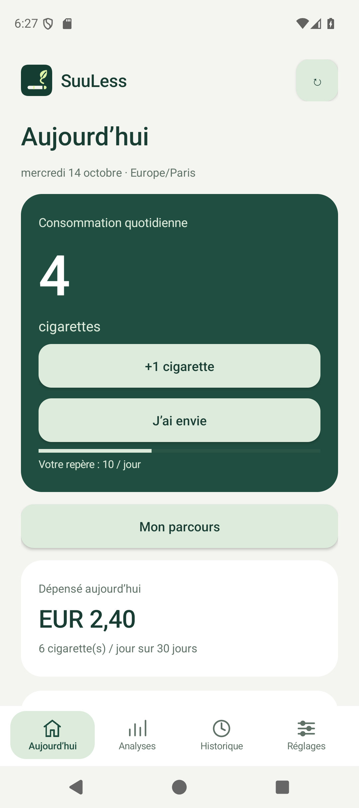
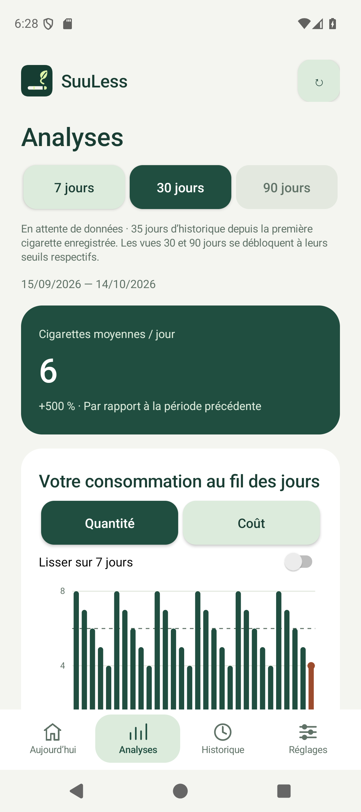

# Android application

[Documentation](../README.md) · [Project home](../../README.md)

The native Java project in [`android/`](../../android) supports Android 8.0 and later. It provides registration, login, entries, history, statistics, settings, a home-screen widget and a personal journey. API-key management and the main consumption CSV export are available on the web; the coaching CSV can also be saved from Android.

The bottom navigation opens Today, Analysis, History and Settings. Today includes +1, daily cost and a seven-day chart. Analysis provides quantity bars, cost lines, averages, daily differences and previous-period comparisons. Selecting a currency does not convert history. Touch charts or use day buttons to inspect values; daily lists provide a text alternative. Backdated entries use date/time pickers.

Native Android screenshots below use a demonstration account and the French interface.

  (sorry about that)

## Build and install

Use JDK 17, Android SDK Platform 36 and Build Tools 35.0.0. The Gradle 8.13 wrapper verifies its download with SHA-256. Android Gradle Plugin is pinned to 8.13.2. Android Studio can open the project.

```sh
# ANDROID_HOME must point to your Android SDK.
cd android
./gradlew assembleDebug lintDebug
adb install -r app/build/outputs/apk/debug/app-debug.apk
```

Enter the server origin, such as `https://suuless.example.com`, without a path, then sign in with the web account. Tokens are encrypted with Android Keystore and Android application backups are disabled. Network access is required. Retry an uncertain entry to reuse its idempotency key.

CI produces an installable debug APK allowing local HTTP and an unsigned release APK requiring HTTPS. Sign the latter with your Android release key before installation. No release key is committed.

## Home-screen widget

After login, use **Settings → Widget and synchronization → Add home screen widget**, or the launcher widget catalog. The widget occupies a horizontal row, defaults to 4 × 1 cells and can resize horizontally.

- +1 records an entry and refreshes the account's daily count.
- Touch the count to refresh, the app button to open the app, or the craving action to open a pause.
- Enabled synchronization refreshes after web/API/Stream Deck changes. Manual refresh and roughly 30-minute periodic updates remain available, subject to Android restrictions. The last-update time uses the phone's time zone.
- An uncertain or offline +1 keeps one pending entry with its original time and idempotency key. Retry after reconnecting; it does not accumulate multiple offline entries.
- Logout or account changes clear cached widget data and pending entries. An expired session requires login.

## Journey and reminders

Open the journey or a craving pause from Today. The journey screen includes goals, steps, daily confirmations, comparisons and CSV export. See [coaching](coaching.md) for calculations and limits.

Optional reminders need network access and notification permission. A periodic job checks the settings; the selected time is not an exact alarm. See [synchronization](../development/synchronization.md) for the separate background SSE service.

## Android version convention

Canonical `vMAJOR.MINOR.PATCH` release tags use the same calculation on GitLab and GitHub:

```text
versionCode = 1000000000 + MAJOR × 1000000 + MINOR × 1000 + PATCH
v0.7.0 → 1000007000
v1.2.3 → 1001002003
```

The shared implementation is [`scripts/ci/android-version-code.sh`](../../scripts/ci/android-version-code.sh). Components have no leading zeroes. MAJOR is at most 1099; MINOR and PATCH are at most 999. Out-of-range stable tags fail the build. The maximum code is 2099999999.

The billion prefix separates releases from earlier small CI counters. Before first distribution, check that installed APK codes are lower than the new release. Use increasing version tags. Retries and platform changes preserve the code for the same tag; compatible updates still require the same signing key. The APK files need not be byte-identical.

Branches, prerelease tags and local script builds use code `1` for testing. `versionName` is the tag without `v`, or a development name containing a CI counter. `ANDROID_VERSION_CODE_OFFSET` is no longer used. Old tags retain their historical build scripts.
