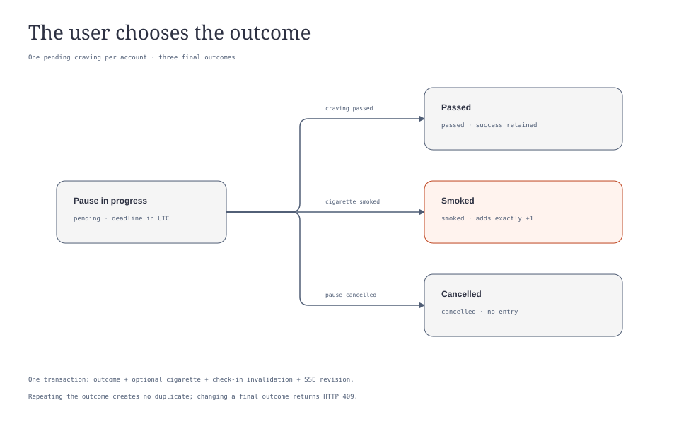
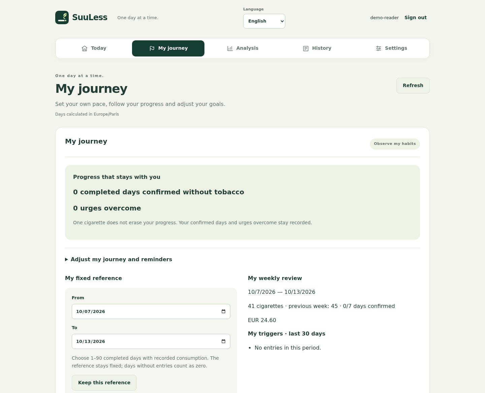

# Journeys, cravings and reminders

[Documentation](../README.md) · [Project home](../../README.md)

The web and Android journey combines user-selected goals, craving pauses, daily confirmations and entry-based progress. The [state diagram](../assets/diagrams/coaching.html) explains craving outcomes.

## Choose a journey

Modes are observe, reduce and quit. Observation imposes no journey goal. Other modes use a daily goal with up to 30 dated steps. On and after the chosen quit date, the goal is zero. Motivation, pause strategy and reminders belong to the account.

A plan version prevents silent overwrites from another device. If a form is stale, reload the journey before saving again.

## Confirm a day

Confirmation validates the displayed count, including zero. A day without entries or confirmation does not count as smoke-free. The confirmed zero-day total excludes today.

Confirmations belong to the account's time zone. Adding or deleting an entry reopens affected confirmations, including those recorded in previous time zones. Confirmations can also be explicitly removed. Interfaces display the last 31 dates, including today.

## Freeze a baseline

Choose 1–90 completed days containing at least one cigarette. This baseline can only be set once: editing old entries does not recalculate it and the current API cannot replace it. Its average includes every selected day, including days without entries, so choose a representative, correctly recorded period.

Progress considers only completed, explicitly confirmed days after the baseline. Costs remain in their original currencies without conversion. A new currency lacking a comparable baseline hides estimated cost differences. Differences can be negative and are comparisons with recorded data, not guaranteed savings.

## Handle a craving

Start a 1–15 minute pause, optionally select a trigger (coffee, stress, meal, social, boredom or other), and choose walking, water, breathing or distraction.

Only one craving can remain pending per account. Select passed, smoked or cancelled. Smoked atomically adds one cigarette at the current price with the craving's trigger. Repeating the same result does not duplicate it. Timer expiry does not choose an outcome or prevent an earlier resolution. Completed outcomes cannot be changed to a different one.

Triggers can also be attached to ordinary entries. Their summary covers 30 days including today. The quit clock starts at the later of the declared quit date and last recorded cigarette; a lapse does not erase past confirmations or passed cravings.

## Reports and export

Weekly reports compare the last seven completed days with the previous seven and show confirmed-day counts. The coaching CSV covers the last 30 completed days: date, time zone, quantity, confirmation, goal calculated from the current plan and historical costs. It is available on web and Android. Recorded counts do not prove abstinence.

## Optional reminders

Daily and weekly reminders are disabled by default. Set times in the account's time zone and a quiet interval. Enabled reminder times inside quiet hours are rejected. Equal quiet start/end times disable the quiet interval.

- Web reminders appear only while the interface is open and visible; they are not browser-closed push notifications.
- Android uses a periodic network job and requires notification permission. Battery restrictions can delay delivery; the selected time is not an exact alarm.

Settings are shared, but duplicate prevention is local to each device/browser, so multiple devices may each display a reminder.

## Data and resources

Journeys, confirmations and cravings remain associated with the account on your server. The selected country chooses a support-resource link; opening it navigates to that external website. No automatic account-data transfer is implemented.

See the [API guide](../api/README.md#synchronization-and-coaching) and [OpenAPI contract](../api/openapi.yaml) for integration details.
