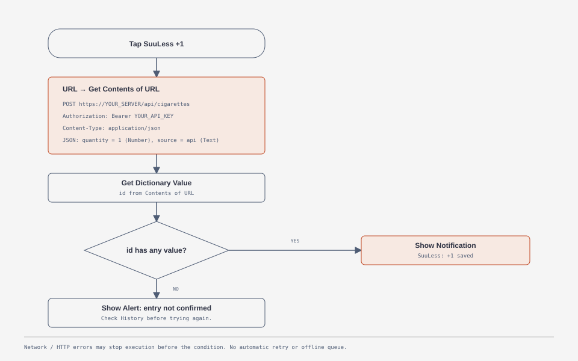

# iPhone: the “SuuLess +1” shortcut

[Documentation](../README.md) · [API guide](../api/README.md)

Use Apple's **Shortcuts** app to record one cigarette from your iPhone Home Screen. After creating a personal API key, [install the prepared shortcut](#install-the-prepared-shortcut) or [build it manually](#2-build-the-shortcut). Neither approach requires building an iOS app or enrolling in the Apple Developer Program.

This is a button that sends a request to your SuuLess server. It requires a network connection and does not provide a continuously updated consumption counter or an offline queue. Depending on the actions and permissions, iOS may open Shortcuts or ask for interaction. See [Apple's widget guide](https://support.apple.com/en-by/guide/shortcuts/apd029b36d05/ios).

## Before you start

- Install or open **Shortcuts** on your iPhone.
- Open your SuuLess instance in Safari and check that you can sign in with an ordinary user account. Administrator accounts cannot record consumption.
- Use an HTTPS address with a certificate trusted by the phone. A server accessible only on your home network requires that network or a suitable VPN when away.
- Check your time zone and pack price in SuuLess. The shortcut records the current time and uses your current price; daily totals follow your account's time zone.

## 1. Create a personal API key

In the SuuLess web interface, open **Settings & integrations → API keys & sessions**. Create a key named `iPhone +1` and copy its value immediately: it cannot be displayed again.

The key grants full access to your account and expires after 365 days. Keep it private, revoke it from the same screen if exposed, and replace it in the shortcut when it expires. Do not use your password or a temporary browser session token. Do not share an exported shortcut or an iCloud shortcut link containing your key.

## Install the prepared shortcut

Download [**SuuLess-Plus-One.shortcut**](../../iphone/SuuLess-Plus-One.shortcut), the signed export. On GitHub or GitLab, use the file's **Download / Raw** action to save the actual `.shortcut` file rather than its preview page. The `.UNSIGNED.shortcut` and `.json` files are maintenance sources, not the files to install.

1. Save the file to your iPhone, then open it with **Shortcuts**. Inspect the actions before adding it.
2. When prompted for **SuuLess API endpoint**, enter your complete endpoint, for example `https://suuless.example.com/api/cigarettes`, replacing the example domain with your server. Include `/api/cigarettes` exactly once, without a trailing slash. The shortcut does not append it automatically.
3. When prompted for **SuuLess API Key**, paste the personal key created above, without `Bearer `, quotation marks or extra whitespace. The shortcut adds the prefix itself.
4. In the editor, check that **Get Contents of URL** points to your own HTTPS server. Replace the supplied default address: the current export still contains the author's instance address. Your key will be sent to the configured destination.
5. Run **SuuLess +1** once, allow access to your server if iOS asks, and check that exactly one new entry appears in SuuLess History. This test records a real cigarette; delete the test entry afterward if needed.
6. Continue directly to [Add the Home Screen widget](#4-add-the-home-screen-widget). You do not need to rebuild the actions below.

The two answers are saved during setup; they are not requested on each tap. To change them later, edit the URL in **Get Contents of URL** and the key in the first **Text** action. Keep the Authorization header's reference to that Text action.

The prepared shortcut displays **“Request sent. Check SuuLess for the new record.”** It does not verify the returned entry ID. After a timeout or uncertain result, check History before tapping again to avoid duplicates. To add response checking, follow [step 3](#3-confirm-that-the-entry-was-saved), replacing the existing notification with the conditional actions described there.

The signed payload and setup parameters have been inspected, and its request body has been tested against the API. Signature trust, import and execution still need validation on an iPhone. If iOS refuses the file, use the manual instructions below or obtain a fresh export from Apple Shortcuts. See the [shortcut folder README](../../iphone/README.md) for file details and export instructions.

## 2. Build the shortcut

Use this alternative if you prefer to create the shortcut yourself. If you installed the prepared file, skip to [widget setup](#4-add-the-home-screen-widget), or use step 3 to improve its confirmation behavior.

Create a new shortcut with **+** in Shortcuts and name it **SuuLess +1**. The action names below are in English; their translations and the location of expanded options depend on your iOS version.

1. Add a **URL** action with `https://suuless.example.com/api/cigarettes`. Replace `https://suuless.example.com` with your actual SuuLess address.
2. Add **Get Contents of URL** and make sure its input is the output of the URL action. Expand its options and select **POST**.
3. Add these **Headers**:

   | Key | Value |
   |---|---|
   | `Authorization` | `Bearer YOUR_API_KEY` |
   | `Content-Type` | `application/json` |

   Replace `YOUR_API_KEY` with the personal key. Keep one space after `Bearer`; do not add quotes or put the key in the URL.

4. Set **Request Body** to **JSON** and add these fields using **Add new field**:

   | Key | Field type | Value |
   |---|---|---|
   | `quantity` | Number | `1` |
   | `source` | Text | `api` |

   This sends `{"quantity":1,"source":"api"}`. Do not paste the entire JSON object into a text field. Leave timestamps unset so the server records the time of the request.

Apple describes the URL action, HTTP method and JSON body options in its [web API instructions](https://support.apple.com/en-in/guide/shortcuts/apd58d46713f/ios).

## 3. Confirm that the entry was saved

After **Get Contents of URL**, add the following actions. If you imported the prepared shortcut, first remove its existing **Show Notification** action so it does not run before the response is checked:

1. **Get Dictionary Value**: get the value for `id` from the **Contents of URL** result. A successful SuuLess response contains the saved entry's ID.
2. **If**: choose the dictionary value as input and the condition **has any value**.
3. Inside the If branch, add **Show Notification** with `SuuLess: +1 saved`.
4. Inside **Otherwise**, add **Show Alert** with `Entry not confirmed. Check SuuLess history before trying again.`
5. Keep **End If** after both branches.

Do not place the success notification after End If: it would also run after a failed response. Network or HTTP failures may stop the shortcut before it reaches the condition; treat the Shortcuts error as an unconfirmed result.

*Configuration schematic, not an iOS screenshot. [Open the editable HTML diagram](../assets/diagrams/iphone-shortcut.html). No real iPhone capture or on-device validation is available for this guide yet.*

Run the shortcut once in the editor. Allow access to your server if iOS asks, then verify that exactly one entry appears in SuuLess History. **This test records a real cigarette**; delete the test entry from History afterward if needed.

## 4. Add the Home Screen widget

1. Hold an empty area of the Home Screen, then open the widget gallery using **Edit → Add Widget** or **+**, depending on iOS.
2. Find **Shortcuts**, choose the small widget and add it.
3. Hold the widget, select **Edit Widget**, then select **SuuLess +1** as its shortcut.
4. Tap outside the widget to finish. Tapping the button now runs your shortcut.

For a larger widget, choose a Shortcuts folder containing SuuLess +1. Apple's [widget instructions](https://support.apple.com/en-by/guide/shortcuts/apd029b36d05/ios) explain the single-shortcut and folder variants.

If you prefer an app-sized icon, open the shortcut's details/menu, choose **Add to Home Screen**, select its name and icon, then add it. This launches the same shortcut. See Apple's [Home Screen instructions](https://support.apple.com/en-euro/guide/shortcuts/apd735880972/ios).

## Troubleshooting

| Symptom | What to check |
|---|---|
| `401` / authentication error | Use a personal API key that has not expired or been revoked. Check the `Bearer ` prefix and accidental spaces or line breaks. |
| `403` / forbidden | Use an ordinary consumption account, not an administrator account. |
| `400` / invalid request | Select JSON, use Number `1` for `quantity`, and Text `api` for `source`. |
| HTML response, login page or missing `id` | Check the full `/api/cigarettes` URL and any reverse proxy login or redirect. |
| Certificate or connection error | Check HTTPS trust, server availability, Wi-Fi/VPN and the address from the phone. Do not disable certificate checks. |
| No notification | Check Shortcuts notification permissions and inspect SuuLess History before retrying. |
| Timeout or two entries | A timed-out request may already have been saved. Check History before running again; each new run can create another entry. Remove an accidental duplicate in History. |

The basic shortcut above does not retry automatically. If you extend it with retries, generate one unique `Idempotency-Key` per intended entry and reuse it only for retries of that same request. Never use a fixed key for every run: subsequent taps would return the original entry instead of recording another one. See the [API's request semantics](../api/README.md#settings-entries-and-statistics).
