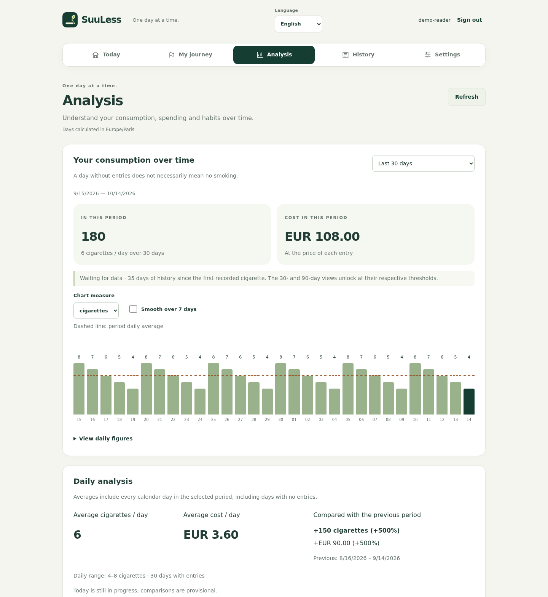
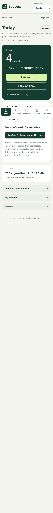

# Usage and statistics

[Documentation](../README.md) · [Project home](../../README.md)

English web interface with synthetic demonstration data.

## Entries and historical costs

Accounts have independent settings, history and revocable API keys. Add one or several cigarettes, backdate an entry, or delete an incorrect entry. Price, pack size, currency, language, daily reference and time zone belong to the account.

Costs are recorded at entry time: changing a pack price does not rewrite history. Backdated entries use the current price. The daily reference does not prevent entries above it. CSV export and API-key management are available on the web.

Statistics describe entries, not automatically measured consumption. A day with no entries is not necessarily smoke-free. Period averages include empty calendar days; today's data is incomplete.

## Analysis

The 30- and 90-day shortcuts remain disabled until calendar history reaches their threshold. History age starts with the first entry in the account's time zone and does not require an entry every day. If the selected preset becomes unavailable after deletion, selection falls back to 7 days. Custom date ranges remain available. The API exposes `history_start` and `history_days` independently of the selected range.

The date filter controls charts, averages and daily rows. Charts switch between quantities and costs. Currencies remain separate, without conversion; the dashed line is the period average. Optional smoothing uses up to seven days within the selected range.

Hourly charts group quantities by local hour, including grouped entries. Repeated daylight-saving hours are combined. Weekday averages divide by the number of occurrences of each weekday in the selected period, including empty days. Both distributions include today's partial data.

The 30-day estimate multiplies the average of completed days in the selected range by 30, excluding today. It assumes the recorded rate and historical costs continue; it is not a forecast of future behavior. No estimate is shown without completed days. Android and web include textual alternatives to charts.

Daily rows show quantity, cost and differences from the period average. Period totals are compared with the immediately preceding range of equal calendar length: January 8–14 is compared with January 1–7. Empty days count as zero and today is explicitly marked incomplete. Percentages without a nonzero reference display a dash. Comparisons before January 1, 2000 are unavailable. Calculations happen before display rounding, so sums of rounded values may differ slightly.

## Languages and currencies

English is the default, regardless of browser or phone language. English, French and Japanese are available before and after login. Authenticated preferences are stored on the server; pre-login choices are local. API messages, dates, numbers and currency labels follow the selected language.

Saving preferences updates only changed fields; currency and price are always submitted together. The web interface refreshes automatically every 10 seconds while its tab is visible and online, and when you return to it or reconnect. Entries added from Android, an iPhone shortcut or another session appear without reloading the page. Unsaved settings and journey edits are preserved, along with already loaded history rows. An unfinished custom date range pauses automatic refresh until applied. Android's settings refresh replaces the form with server values.

Currencies come from Babel/CLDR with localized names and decimal precision: for example EUR 12.50, JPY 600 or KWD 1.234. Changing currency requires a new price. Historical entries retain their original currency and exports include it; no exchange-rate conversion takes place.

## Time zones

The geographic selector uses `zone1970.tab` from the pinned `tzdata` package, with UTC added. Technical aliases and duplicate names are hidden from new selections, but valid legacy values remain usable. Regions with the same current offset can remain separate because their historical rules differ.

Each option shows a city/region, primary country, current UTC offset and IANA identifier. Search supports translated cities and countries, country codes, identifiers and old names; it ignores case and accents. Offsets are recalculated when the catalog loads. For example, `Calcutta` finds `Asia/Kolkata`.

Web registration detects the browser's time zone; Android uses the device's zone. Known aliases are normalized, with UTC as the UI fallback. Logging in does not change an existing preference. API registration without `timezone` retains the historical `Europe/Paris` default.

Instants are stored in UTC. The account's time zone controls display, backdated local entries and daily boundaries. Historical offsets are computed at the entry's instant. A repeated local time selects its first occurrence; explicit `occurred_at` with an offset can select the other. A nonexistent spring-forward local time is rejected. Existing valid aliases such as `US/Eastern` remain visible as the account's current setting until explicitly changed.

Translations live in `server/static/locales/{en,fr,ja}.json` and Gradle copies them into Android assets. Adding a language requires matching keys and placeholders, server language registration and web/Android selectors, followed by tests and an APK rebuild.

## Personal journey

See [coaching](coaching.md) for goals, craving pauses, daily confirmations and reminders. Consumption statistics and progress based on confirmed days intentionally have different scopes.

## Mobile web interface

The responsive web interface works in a phone browser. For the native application and home-screen widget, see [Android](android.md).

## Download and share consumption records

Open **Analysis** or **History → Export / share** on the web or Android. First choose the **last 7, 30 or 90 days**, including today in your account's time zone, then choose the file format and download/share action. This export period is independent of the dates displayed in Analysis or History and does not change them. All three durations remain available even with a shorter recorded history; missing days are identified in the report.

- **CSV** contains individual entries with local timestamps (including UTC offset), quantities, historical costs, currencies and entry source. It can be opened in spreadsheet software.
- **Consumption report (HTML)** is a self-contained document with the selected dates, generation time, time zone, total recorded cigarettes, daily average, days without entries, historical costs by currency and daily figures. It contains no account name or identifier. Open the downloaded file in a browser to print it or choose **Save as PDF** in the print dialog. PDF is produced by the browser, not by the server.

The report can support a conversation with a tobacco cessation specialist. It is a record of user-entered data, not a medical assessment. A day with no entries is not treated as confirmed abstinence, and currencies are never converted or added together.

On Android, choose a format, then **Save file** or **Share**. The save picker lets you choose the destination; the share sheet lets you choose the recipient application. The app grants read access only to the selected temporary export. On the web, file sharing depends on browser and device support; if unavailable, download the file and attach it yourself. Nothing is sent automatically. Shared copies contain personal consumption information and no longer update when you edit your history.
